<!-- Generado por generador/generar.py: cambia los textos allí y vuelve a ejecutarlo. -->

  <picture><source media="(prefers-color-scheme: dark)" srcset="assets/banner-oscuro.svg"></picture>

  <a href="https://www.linkedin.com/in/eriicperezz/"><picture><source media="(prefers-color-scheme: dark)" srcset="assets/boton-linkedin-oscuro.svg"></picture></a>
  <a href="https://www.instagram.com/eriicpeerezz_/"><picture><source media="(prefers-color-scheme: dark)" srcset="assets/boton-instagram-oscuro.svg"></picture></a>

<h3 align="center">Sobre mí</h3>

  Me encanta la informática, sobre todo la <b>ciberseguridad</b> y la <b>inteligencia artificial</b>. 
  Trabajo como <b>administrador de sistemas en Daumar</b> y estudio un <b>máster en ciberseguridad</b>. 
  Soy técnico superior en <b>ASIR</b> y hablo castellano, catalán e inglés.

<h3 align="center">Proyectos</h3>

  <a href="https://motorflux.es"><picture><source media="(prefers-color-scheme: dark)" srcset="assets/proyecto-motorflux-oscuro.svg"></picture></a>
  <a href="https://bellastudio.es/"><picture><source media="(prefers-color-scheme: dark)" srcset="assets/proyecto-bella-oscuro.svg"></picture></a>
  <a href="https://github.com/eriizzo/ErizoCoach"><picture><source media="(prefers-color-scheme: dark)" srcset="assets/proyecto-erizocoach-oscuro.svg"></picture></a>

<h3 align="center">Con qué trabajo</h3>

  <picture><source media="(prefers-color-scheme: dark)" srcset="assets/tecnologias-oscuro.svg"></picture>

<h3 align="center">Actividad</h3>

  <picture>
    <source media="(prefers-color-scheme: dark)" srcset="https://raw.githubusercontent.com/eriizzo/eriizzo/output/serpiente-oscuro.svg">
    
  </picture>

